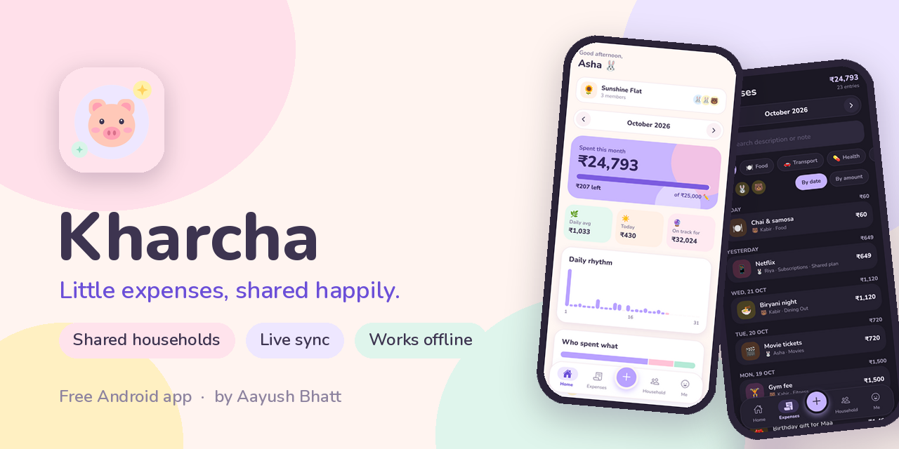
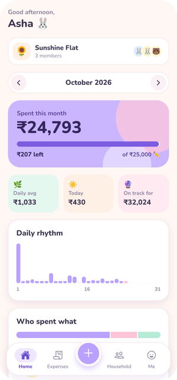
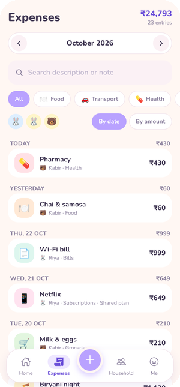
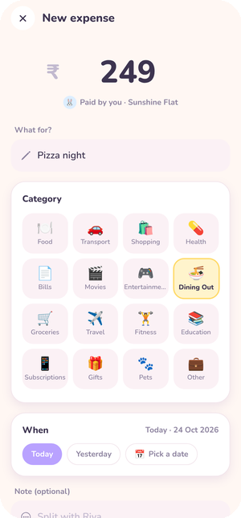
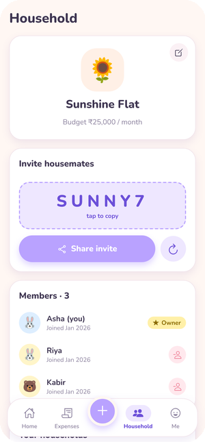
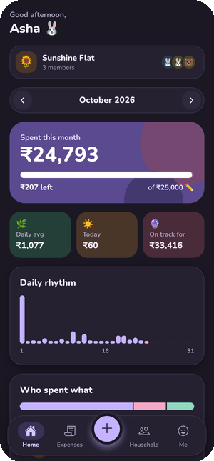
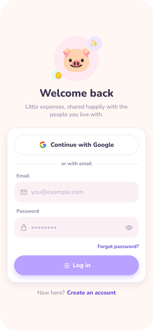

 
 

 
 

 

## 🐷 What is Kharcha?

**Kharcha** (खर्चा, *“expense”* in Hindi) is a cute, simple expense tracker for the people you live with.

Create a household for your flat or family, invite everyone with a 6-letter code, and add expenses together. Everyone sees new entries instantly, and the app shows you the monthly total, how much budget is left, and who spent what.

 

## 📱 Screenshots

<table>
  <tr>
    <td align="center"> <b>Home</b> — budget & insights</td>
    <td align="center"> <b>Expenses</b> — search & filter</td>
    <td align="center"> <b>Add</b> — in a few taps</td>
  </tr>
  <tr>
    <td align="center"> <b>Household</b> — invite & members</td>
    <td align="center"> <b>Dark mode</b> 🌙</td>
    <td align="center"> <b>Sign in</b> — Google or email</td>
  </tr>
</table>

 

## ✨ Features

| | |
|---|---|
| 🏡 **Shared households** | Make one for your flat, your family, or both. Invite people with a 6-letter code. |
| ⚡ **Live sync** | When someone adds an expense, it appears on everyone’s phone within seconds. |
| ☁️ **Works offline** | No signal? Add expenses anyway — they sync automatically when you’re back online. |
| 💰 **Monthly budget** | See what’s spent, what’s left, and what you’re on track to spend this month. |
| 📊 **Insights** | Daily spending chart, category breakdown, and who-spent-what. |
| 🔎 **Search & filters** | Find any expense by name, note, category, or person. |
| 🍽️ **16 categories** | Food, groceries, bills, travel, dining out, subscriptions, pets and more. |
| 🔐 **Sign in your way** | Continue with Google, or use email and password. |
| 💻 **Desktop import** | Bring your history over from the Kharcha desktop app’s `data.json`. |
| 🌸 **Pastel light & dark themes** | Easy on the eyes, day or night. |

 

## ⬇️ How to install

1. **On your Android phone**, tap **[Download Kharcha.apk](https://github.com/aayushbhatt-18/Kharcha-Releases/releases/latest/download/Kharcha.apk)**.
2. Open the downloaded file.
3. If Android asks, allow **“Install unknown apps”** for your browser. This is normal for apps installed outside the Play Store.
4. Tap **Install**, open Kharcha, and sign up 🎉

> **Updating:** download the latest APK the same way and install it over the old one. Your account and expenses stay — they’re stored online, not on the phone.

 

## ❓ FAQ

<b>Is it free?</b>

 
Yes — completely free, with no ads and no subscriptions.

<b>Android says “Unsafe app” or “Unknown app” — is it safe?</b>

 
Android shows this for every app that isn’t installed from the Play Store. Kharcha doesn’t ask for your contacts, camera, photos or location — it only needs the internet to sync. If Play Protect shows a warning, tap <b>More details → Install anyway</b>.

<b>Who can see my expenses?</b>

 
Only the members of your household. Each household’s data is protected so other users can’t see it, and you can delete your account and data anytime from <b>Me → Delete account</b>.

<b>Is there an iPhone version?</b>

 
Not yet — Kharcha is Android-only for now.

<b>I use the Kharcha desktop app. Can I keep my old expenses?</b>

 
Yes. In the desktop app, click <b>Export</b> (or use your <code>data.json</code>), send the file to your phone, then open <b>Me → Import from desktop app</b> in the mobile app. Importing the same file twice won’t create duplicates.

<b>I found a bug / I have an idea</b>

 
Please <a href="https://github.com/aayushbhatt-18/Kharcha-Releases/issues/new">open an issue</a> or email <a href="mailto:aayushbhatt18@gmail.com">aayushbhatt18@gmail.com</a>. You can also use <b>Me → About Kharcha → Send feedback</b> inside the app.

 

## 🧑‍💻 About the developer

<table>
  <tr>
    <td width="130" align="center" valign="top">
      
    </td>
    <td valign="top">
      <h3>Aayush Bhatt</h3>
      Software developer who loves building tools. 
      📍 Lives in Pune · from Chittorgarh, Rajasthan
        
      I first built Kharcha as a small desktop app to keep an eye on my own spending. It worked so well that I wanted something my flatmates and family could share too, so Kharcha grew into this app, where everyone in a home can add expenses together.
        
      
      
      
    </td>
  </tr>
</table>

 

## ☕ Buy me a chai

Kharcha is free and always will be. If it makes life in your home a little easier, you can buy me a chai — totally optional, always appreciated 💜

**UPI:** `aayushbhatt18-1@okicici`

Open any UPI app (GPay, PhonePe, Paytm…) → Pay to UPI ID → paste the ID above. Or use the <b>Buy me a chai</b> button inside the app: <b>Me → About Kharcha</b>.

 

---

 
Made with 💜 in India by <a href="https://github.com/aayushbhatt-18">Aayush Bhatt</a>

